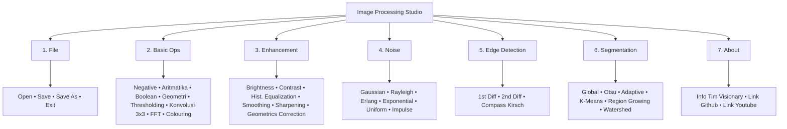

# Image Processing Studio 🎨
> **Aplikasi Desktop Pengolahan Citra Digital (PCD) Berbasis Python & Tkinter**  
> Dikembangkan oleh **Tim Visionary** • Update: 24/11/2026

[](https://www.python.org/)
[](https://docs.python.org/3/library/tkinter.html)
[](https://numpy.org/)
[](https://python-pillow.org/)
[](https://matplotlib.org/)
[](#tim-pengembang)

---

## 📌 Tentang Aplikasi

**Image Processing Studio** adalah aplikasi desktop pengolahan citra komprehensif yang dirancang untuk memenuhi seluruh standar kurikulum mata kuliah **Pengolahan Citra Digital (PCD)**. 

Aplikasi ini mengusung konsep **Non-Destructive Dual-Panel Editing**, di mana citra asli (*Original Image*) selalu disimpan utuh tanpa modifikasi, sementara seluruh rangkaian transformasi dijalankan secara berurutan pada panel hasil (*Result Image*) dengan dukungan fitur **Undo** riwayat operasi bertahap.

Antarmuka dibangun dengan estetika modern bertema **Dark Obsidian Navy** menggunakan modul bawaan Python `tkinter` dan `tkinter.ttk`, serta tipografi modern *Segoe UI Variable Display* untuk kenyamanan visual maksimal.

---

## ✨ Fitur Utama (Menu Structure)

Struktur menu aplikasi mengacu pada panduan kurikulum standar PCD:



### 1. File
* **Open… (`Ctrl+O`)** : Membuka file gambar (PNG, JPEG, BMP, TIFF, WebP, GIF).
* **Save (`Ctrl+S`)** : Menyimpan langsung perubahan citra hasil ke file sumber yang sedang dibuka.
* **Save As… (`Ctrl+Shift+S`)** : Mengekspor hasil pengolahan citra ke file baru dengan pilihan format.
* **Reset Asli** : Mengembalikan citra hasil ke kondisi awal gambar asli.
* **Undo (`Ctrl+Z`)** : Membatalkan langkah operasi sebelumnya (riwayat hingga 20 langkah).
* **Exit (`Ctrl+Q`)** : Keluar dari aplikasi dengan proteksi konfirmasi perubahan yang belum tersimpan.

### 2. Basic Ops (Operasi Dasar)
* **Negative** : Pembalikan intensitas citra ($I' = 255 - I$).
* **Arithmetic** : Operasi aljabar citra (Penjumlahan `+`, Pengurangan `-`, Perkalian `*`, Pembagian `/`) dengan pilihan nilai skalar slider maupun memadukan citra kedua dari file.
* **Boolean** : Operasi logika piksel biner (`NOT`, `AND`, `OR`, `XOR`) terhadap masker biner atau citra kedua.
* **Geometrics** :
  * **Translation** : Pergeseran koordinat spasial $\Delta X$ dan $\Delta Y$.
  * **Rotation** : Pemutaran citra sudut bebas ($-180^\circ$ s.d $+180^\circ$) dan preset $90^\circ, 180^\circ$.
  * **Zooming** : Penskalaan citra dari $10\%$ hingga $400\%$ menggunakan interpolasi Lanczos/Bicubic.
  * **Flipping** : Pembalikan cermin Horisontal (kiri-kanan) dan Vertikal (atas-bawah).
  * **Cropping** : Pemotongan koordinat bidang minat $(X_1, Y_1)$ hingga $(X_2, Y_2)$.
* **Thresholding** : Pengambangan biner berdasarkan ambang batas $T \in [0, 255]$.
* **Convolution** : Konvolusi matriks $3\times3$ kustom interaktif dilengkapi preset soal kurikulum:
  $$\begin{bmatrix} 1 & 2 & 3 \\ 4 & 5 & 6 \\ 7 & 8 & 0 \end{bmatrix}$$
  serta preset Gaussian, Box Blur, Sharpen, Highpass, Sobel, Laplacian, dan Emboss.
* **Fourier Transform** : Transformasi Fourier Cepat 2D (FFT 2D) untuk memvisualisasikan spektrum magnitudo frekuensi dalam skala logaritmik $\log(1 + |F(u, v)|)$.
* **Colouring (Ruang Warna)** :
  * **Binary** (Hitam-Putih 1-bit)
  * **Grayscale** (Luminansi ITU-R 601: $0.299R + 0.587G + 0.114B$)
  * **RGB** (Penyesuaian kanal independen Red, Green, Blue)
  * **HSV** (Hue, Saturation, Value)
  * **CMY** (Cyan, Magenta, Yellow)
  * **YUV** (Luminansi & Krominansi Standar Televisi PAL)
  * **YIQ** (Standar Televisi NTSC)
  * **Pseudo** (Pewarnaan semu citra menggunakan colormap *Jet, Viridis, Plasma, Hot, Cool, Rainbow*, dll.)

### 3. Enhancement (Peningkatan Kualitas Citra)
* **Brightness & Contrast** : Penyesuaian kecerahan dan kontras linear responsif.
* **Hist. Equalization** : Pemerataan histogram pada kanal intensitas untuk meningkatkan kontras global.
* **Smoothing (Penghalusan)** :
  * **Spatial Domain** : Lowpass Filter Gaussian dan Median Filter (pembersih noise impuls).
  * **Frequency Domain** : Ideal Lowpass Filter (ILPF) & Butterworth Lowpass Filter (BLPF).
* **Sharpening (Penajaman)** :
  * **Spatial Domain** : Highpass Filtering & Highboost Filtering ($A \cdot I_{\text{orig}} - I_{\text{lowpass}}$).
  * **Frequency Domain** : Ideal Highpass Filter (IHPF) & Butterworth Highpass Filter (BHPF).
* **Geometrics Correction** : Koreksi distorsi kemiringan sudut (*Shear X/Y*) serta koreksi kelengkungan lensa radial (*Barrel / Pincushion*).

### 4. Noise (Distribusi Gangguan Citra)
* **Gaussian Noise** : Gangguan acak berdistribusi normal $N(\mu, \sigma^2)$.
* **Rayleigh Noise** : Model derau asimetris berdistribusi Rayleigh.
* **Erlang (Gamma) Noise** : Derau berbasis distribusi Gamma dengan parameter *Shape* dan *Scale*.
* **Exponential Noise** : Derau berdistribusi eksponensial negatif.
* **Uniform Noise** : Derau acak seragam $U(-a, +a)$.
* **Impulse Noise** : Derau bintik garam dan lada (*Salt & Pepper*).

### 5. Edge Detection (Deteksi Tepi Citra)
* **1’st Differential Gradient** : Operator gradien ordo pertama (Sobel, Prewitt, Roberts Cross).
* **2’nd Differential Gradient** : Operator turunan kedua (Laplacian, Laplacian of Gaussian / LoG, Canny Edge Detection dengan *Non-Maximum Suppression* & *Hysteresis Tracking*).
* **Compass Edge Detection** : Deteksi tepi berbasis 8 arah mata angin menggunakan operator **Kirsch Compass**.

### 6. Segmentation (Segmentasi Citra)
* **Global Thresholding** : Segmentasi ambang batas tunggal.
* **Otsu Thresholding** : Segmentasi optimal otomatis berbasis maksimasi variansi antarkelas.
* **Adaptive Thresholding** : Pengambangan lokal adaptif berdasarkan rata-rata lingkungan blok tetangga.
* **K-Means Clustering** : Pengelompokan piksel warna berbasis klasterisasi vektor Euclidean ($K = 2 \dots 8$).
* **Region Growing** : Segmentasi pertumbuhan wilayah homogen dari titik benih (*seed*).
* **Watershed** : Segmentasi pemisahan kontur objek berbasis peta gradien morfologi.

### 7. Histogram & Analisis
* **Histogram RGB** : Visualisasi sebaran frekuensi piksel gabungan dan per kanal (Red, Green, Blue) dilengkapi nilai statistik ($\mu$, $\sigma$, median, min-max).
* **Histogram Grayscale** : Grafik intensitas keabuan $0 \dots 255$ beserta ringkasan statistik.
* **Ekspor PNG** : Simpan grafik histogram sebagai gambar siap cetak/laporan.

---

## 🛠️ Arsitektur Kode Program

```
apk/
├── main.py              # GUI Utama, Menu Bar, Dialog Interaktif, dan Event Handler (Tkinter)
├── operations.py        # Modul Matematis Murni Pengolahan Citra (NumPy, PIL, SciPy)
├── histogram.py         # Modul Perhitungan Histogram & Plotting (Matplotlib Figure)
├── requirements.txt     # Daftar Pustaka Python yang Dibutuhkan
├── README.md            # Dokumentasi Ikhtisar Proyek
└── TUTORIAL.md          # Panduan Langkah Pengoperasian Lengkap
```

---

## 🚀 Petunjuk Instalasi & Menjalankan

### 1. Prasyarat Sistem
* Python versi **3.9** atau yang lebih baru.
* Sistem operasi Windows, Linux, atau macOS.

### 2. Kloning / Unduh Repositori
```bash
git clone https://github.com/username/image-processing-studio.git
cd image-processing-studio
```

### 3. Buat dan Aktifkan Virtual Environment (Disarankan)
* **Windows (PowerShell)**:
  ```powershell
  python -m venv .venv
  .\.venv\Scripts\Activate.ps1
  ```
* **Linux / macOS**:
  ```bash
  python3 -m venv .venv
  source .venv/bin/activate
  ```

### 4. Pasang Dependensi
```bash
pip install -r requirements.txt
```

### 5. Jalankan Aplikasi
```bash
python main.py
```

---

## ⌨️ Pintasan Papan Ketik (Keyboard Shortcuts)

| Shortcut | Fungsi |
| :---: | :--- |
| <kbd>Ctrl</kbd> + <kbd>O</kbd> | Membuka file gambar baru |
| <kbd>Ctrl</kbd> + <kbd>S</kbd> | Menyimpan hasil pengolahan citra |
| <kbd>Ctrl</kbd> + <kbd>Shift</kbd> + <kbd>S</kbd> | Menyimpan hasil dengan nama/folder baru (*Save As*) |
| <kbd>Ctrl</kbd> + <kbd>Z</kbd> | Undo (Membatalkan operasi terakhir) |
| <kbd>Ctrl</kbd> + <kbd>Q</kbd> | Keluar dari aplikasi (*Exit*) |
| <kbd>Esc</kbd> | Menutup / membatalkan jendela dialog aktif |
| <kbd>Enter</kbd> | Mengonfirmasi / menerapkan parameter dialog |

---

## 👥 Tim Pengembang: Visionary

Proyek ini dikembangkan oleh **Tim Visionary** untuk memenuhi tugas besar mata kuliah **Pengolahan Citra Digital (PCD)**:

| No | Nama Mahasiswa | NIM | Peran Utama |
| :---: | :--- | :---: | :--- |
| **1** | **Azwa Zahira** | `2407126204` | Lead Developer & Arsitektur GUI |
| **2** | **Bulan Hijarati Asy-Syiddah** | `2407134878` | Algoritma Citra, Filter Spasial & Frekuensi |
| **3** | **Nur Diana Tri Zahara** | `2407111549` | Transformasi, Segmentasi Citra & Histogram |

* **Mata Kuliah** : Pengolahan Citra Digital (PCD)
* **Tanggal Rilis** : 24 November 2026
* **Hak Cipta** : Copyright © 2026 Visionary - All Rights Reserved

---

## 📚 Panduan Lengkap
Untuk panduan langkah demi langkah penggunaan setiap fitur dan studi kasus pengolahan citra, silakan baca [TUTORIAL.md](file:///c:/Users/ACER/Downloads/apk/TUTORIAL.md).
